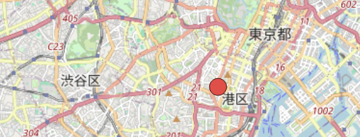

# tcxOpenStreetMap

Slippy-map (OpenStreetMap-compatible) tile renderer for TrussC. Drop a map
into your scene graph, or drive the projection + tile cache yourself from any
draw routine.



*Map data © [OpenStreetMap](https://www.openstreetmap.org/copyright) contributors*

```
addons.make
  tcxOpenStreetMap
```

Depends on `tcxCurl` (auto-resolved by `trusscli addon clone`).

---

## What's in it

| Class | Use for |
|---|---|
| `tcx::MapView` | Node-agnostic core. Lat/lon ↔ pixel projection, viewport math, tile cache + worker, `drawTiles()` at the current draw cursor. Compose into any draw routine. |
| `tcx::MapViewNode : RectNode` | Drop into the scene graph. Built-in left-drag pan, scroll zoom, and pins-as-Nodes. The recommended starting point. |
| `tcx::OSMTileProvider` / `tcx::UrlTemplateTileProvider` | Swappable tile source. OSM default; URL-template covers Mapbox / OpenTopoMap / self-hosted. |
| `tcx::TileJsonTileProvider` | A tile source configured by a [TileJSON](https://github.com/mapbox/tilejson-spec) document — URL templates, zoom range and attribution in one document instead of three places in your code. `OSMTileProvider` is this class preloaded with the document OSM publishes. |
| `tcx::NominatimClient` | Geocoding (place name ↔ lat/lon) via OSM Nominatim. Sync + async, with built-in 1-req/sec throttle per the public-server policy. |

## Quick start

```cpp
#include <tcxOpenStreetMap.h>
using namespace tcx;

void tcApp::setup() {
    auto osm = std::make_shared<OSMTileProvider>();
    osm->setUserAgent("MyAwesomeApp/1.0");        // OSM rejects default UAs

    map_ = std::make_shared<MapViewNode>();
    map_->setSize(800, 600);
    map_->map()
        .setTileProvider(osm)
        .setCenter({35.6586, 139.7454})            // Tokyo Tower
        .setZoom(13);
    addChild(map_);
}
```

Pins are Nodes — add any `RectNode` subclass:

```cpp
auto pin = make_shared<MyPinNode>();
map_->addPin({35.6586, 139.7454}, pin);
```

## Examples

- `example-mapNode/` — recommended path. Right-click anywhere on the map to
  drop a pin Node; left-click pins to log their lat/lon.
- `example-core/` — direct access to `MapView` without the Node wrapper.
  Drives pan/zoom from `keyPressed()`; shows how to project a point yourself.
- `example-search/` — Nominatim geocoding. Type a place name and press Enter;
  the app pans to the match, picks a fitting zoom, and drops a labelled pin.

## Geocoding (Nominatim)

```cpp
NominatimClient nominatim;
nominatim.setUserAgent("MyApp/1.0")
         .setLanguage("ja");

nominatim.searchAsync("Tokyo Tower", [this](auto results) {
    if (results.empty()) return;
    auto& r = results.front();
    double z = NominatimClient::zoomForBoundingBox(
        r, map_->getWidth(), map_->getHeight());
    map_->map().setCenter(r.center).setZoom(z);
});
```

Reverse geocoding (lat/lon → address) uses the same client:

```cpp
auto r = nominatim.reverse({35.6586, 139.7454});
// r.displayName = "Tokyo Tower, Shiba-koen, Minato, Tokyo, Japan"
```

The default throttle (1 request / sec) honours OSM's public-server policy.
Pass `setMinRequestIntervalMs(0)` for a self-hosted Nominatim with no such
restriction.

## Caching

`MapView` keeps two caches:

| Cache | Default | API |
|---|---|---|
| Memory (decoded textures) | 256 tiles, LRU-by-zoom-distance | `setMaxMemoryTiles(int)` |
| Disk (raw PNG bytes) | Per-OS user cache dir, on by default | `setTileCacheDir(string)` |

**Disk cache is on by default** because OSM's tile-usage policy explicitly
asks consumers to cache repeated requests. The default location is:

| OS | Path |
|---|---|
| macOS | `~/Library/Caches/tcxOpenStreetMap` |
| Linux | `$XDG_CACHE_HOME/tcxOpenStreetMap` (else `~/.cache/tcxOpenStreetMap`) |
| Windows | `%LOCALAPPDATA%\tcxOpenStreetMap\Cache` |

To opt out (e.g. you ship a self-contained kiosk image with no writable disk),
pass an empty string: `setTileCacheDir("")`.

> The addon **never deletes from disk** — it only writes. A long-running app
> that pans a lot will grow the cache forever. Rotate the dir or sweep it
> from your application as makes sense for your platform; disk-pruning was
> kept out of the addon to avoid platform-specific glob/atime work.

## Multi-level tile fallback

While the real tile is loading, `MapView` displays the closest match it
already has — there's no "blank gray flash" in normal use:

- Zoom in past a loaded area → parent tile is drawn stretched.
- Zoom out past a loaded area → the 4 immediate child tiles composite
  into the coarser cell.
- Walk-up keeps going (parent of parent, …) until something hits or it
  runs out of zoom; walk-down stops at +1 to bound the per-frame lookup
  count.

Only when both walks miss does the grey placeholder appear.

## Zoom snap threshold

`MapView` renders integer-zoom tiles and scales them to fit the current
fractional zoom. `setZoomSnapThreshold(t)` controls when the integer level
flips:

```
z = 13.4, t = 0.5 (default)  → renders zoom 13 tiles
z = 13.6, t = 0.5            → renders zoom 14 tiles
z = 13.6, t = 0.7            → still renders zoom 13 (saves a tile round trip)
```

Lower threshold = eager switch to detail (more downloads). Higher = stay on
coarse longer (fewer downloads, slightly blurrier during zoom-in).

## OSM tile policy & attribution

If you publish an app that uses `OSMTileProvider`, please:

1. **Show the attribution "© OpenStreetMap contributors"** — visible on or
   near the map, or in an about/credits screen where an overlay is
   impractical. Map data is licensed under the
   [ODbL](https://www.openstreetmap.org/copyright) and attribution is a
   condition of use, not a courtesy.
   Read it from `map.attribution()` rather than hardcoding it, so it follows
   the tile source if you swap providers. It contains HTML (OSM's is a link);
   `attributionText()` strips the tags for bitmap-font overlays.
2. Set `setUserAgent(...)` to something that identifies your app.
3. Keep disk caching on (it is by default — see above).
4. Stay within OpenStreetMap's tile-usage policy:
   https://operations.osmfoundation.org/policies/tiles/

For higher volumes, swap in `UrlTemplateTileProvider` and a paid tile host
(Mapbox, MapTiler, …) or self-host via tile-server-php / TileServer GL.

## License

The addon code is MIT. Map data and tiles fetched at runtime are
© OpenStreetMap contributors (ODbL) and are subject to OSMF usage policies —
see `LICENSES.md` for the details, including what your app must attribute.
